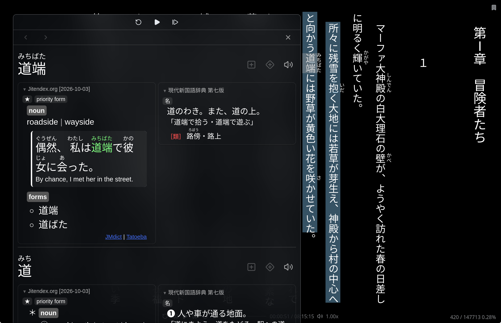

# Hoshi Reader for Linux (unofficial)

> **This is an unofficial, community-made Linux port.** It is not made, endorsed or
> supported by the Hoshi Reader author. Please report problems with *this build*
> [here](../../issues), not to the upstream project.

[Hoshi Reader Desktop](https://github.com/Manhhao/Hoshi-Reader-Desktop) by
[Manhhao](https://github.com/Manhhao) is a Japanese EPUB reader with a pop-up
dictionary, Anki mining and audiobook support (Sasayaki), built with Tauri and Svelte.
Upstream ships macOS and Windows builds only. This repository holds a small set of
patches that make it build and run on Linux, plus the packaging to install it.



| | |
|---|---|
| **Based on upstream** | v1.2.0 |
| **Linux build revision** | 1.2.0-2 |
| **Platform** | Linux x86_64 |
| **Tested on** | Arch Linux, KDE Plasma (Wayland): package and AppImage<br>Ubuntu 26.04.1, GNOME: AppImage |
| **License** | GPL-3.0-or-later, same as upstream |

## Install

| You use | Install |
|---|---|
| Arch Linux (or an Arch-based distribution) | the [Arch package](#arch-linux-build-the-package-yourself) |
| Anything else: Ubuntu, Fedora, Debian, … | the [AppImage](#other-distributions-appimage-experimental) |

### Arch Linux: build the package yourself

```sh
git clone https://github.com/YashaNoos/Hoshi-Reader-for-Linux-unofficial-.git
cd Hoshi-Reader-for-Linux-unofficial-/arch
makepkg -si
```

The first build takes about 10 minutes and a few GB of disk space and needs a network
connection (it downloads upstream's source at the matching release tag, applies the
patches in [`arch/`](arch), and fetches the Rust and Node dependencies).

### Arch Linux: pre-built package

Download the `.pkg.tar.zst` from the [Releases](../../releases) page, check it against
the `.sha256` file next to it, and install it:

```sh
sha256sum -c hoshi-reader-linux-*.pkg.tar.zst.sha256
sudo pacman -U hoshi-reader-linux-*.pkg.tar.zst
```

Pre-built packages are built by [GitHub Actions](.github/workflows/build-arch.yml) from
this repository in a clean Arch container. Arch is a rolling release: if a system
update breaks a pre-built package, rebuild it with `makepkg` or wait for a new release.

### AUR

An AUR package is planned.

### Other distributions: AppImage (experimental)

One file that runs without installing anything. Download the `.AppImage` from the
[Releases](../../releases) page, check it, make it executable and start it:

```sh
sha256sum -c Hoshi-Reader-for-Linux-*.AppImage.sha256
chmod +x Hoshi-Reader-for-Linux-*.AppImage
./Hoshi-Reader-for-Linux-*.AppImage
```

- **Requirements:** x86_64 and glibc 2.39 or newer (Ubuntu 24.04, Fedora 40, Debian 13
  or later). It is built on Ubuntu 24.04 and does not run on older systems.
- **A Japanese font** must be installed on the system, for example Noto Sans CJK JP
  (Ubuntu/Debian: `fonts-noto-cjk`, Fedora: `google-noto-sans-cjk-fonts`; most
  desktop installs already have one).
- **It is large** (~175 MB) because it carries its own WebKitGTK, GTK and GStreamer.
- **App menu entry:** the AppImage does not add one by itself.
  [Gear Lever](https://flathub.org/apps/it.mijorus.gearlever) (from Flathub) can add it
  to your app menu and keep track of updates.
- **Updating:** download the new AppImage from the Releases page and replace the old
  file. Your library is kept (see [Where things are stored](#where-things-are-stored)).
- **Anki** installed as a Flatpak or Snap works.

The AppImage is built by [GitHub Actions](.github/workflows/build-arch.yml) from the
same upstream tag and patches as the Arch package. It is new: please report problems,
with your distribution and desktop.

### Building on other distributions

The patches should apply anywhere upstream's
[build requirements](https://github.com/Manhhao/Hoshi-Reader-Desktop#development)
are met (Rust, Node with pnpm, CMake, a C++23 compiler, WebKitGTK 4.1). The
[AppImage job](.github/workflows/build-arch.yml) shows the steps on Ubuntu 24.04.

## Limitations

Please read these before installing.

- **Google Drive sync does not work out of the box.** The official builds contain
  Google credentials that are not part of the public source, so a build from source
  cannot sign in. If you create your own Google Cloud OAuth client, you can build with
  `HOSHI_GOOGLE_CLIENT_ID` and `HOSHI_GOOGLE_CLIENT_SECRET` set (see the comment in the
  [PKGBUILD](arch/PKGBUILD)); sign-in tokens are kept in KWallet or GNOME Keyring. This path
  is implemented but **has not been tested**. If you rely on syncing with the iOS or
  Android apps, this build is not for you yet.
- **Sasayaki transcription** works, for Japanese audio only. On first use it downloads
  the ~160 MB ReazonSpeech model from Hugging Face into
  `~/.cache/de.manhhao.hoshi/Models/` and checks it with SHA-256. After that it runs
  fully offline. It was verified on short test audio (mp3, m4b, flac) but not on
  full-length audiobooks.
- **Tested on few setups:** Arch Linux with KDE Plasma on Wayland (package and
  AppImage) and Ubuntu 26.04.1 with GNOME (AppImage). Other desktops, X11 and other
  distributions are unverified.
- **x86_64 only.**
- **No in-app updates.** The updater is disabled on Linux; update through your package
  manager, or download the new AppImage from the Releases page.
- **Highlights in vertical text sit slightly high.** WebKitGTK draws vertical text about
  0.13em below where it lays it out, so highlights drawn by the browser look shifted up.
  The lookup highlight is corrected; your colored highlights, search results and the
  Sasayaki line highlight still show the offset.
- **Fullscreen can go black with fractional scaling and several monitors.** On KDE
  Plasma, with a fractional scale (e.g. 175%) on one monitor and a second monitor at a
  different refresh rate, a fullscreen Hoshi window can turn that screen black while the
  mouse cursor is over it (seen on an AMD GPU). This comes from KWin and the
  graphics driver, not from Hoshi. Using a whole-number scale (100% or 200%) on that
  monitor avoids it.
- **A Japanese font is required.** The Arch package depends on `noto-fonts-cjk`; for
  the AppImage, install one yourself (see above). Without it, fontconfig falls back to
  a Chinese font.

## What is different from upstream

Each patch in [`arch/`](arch) is one self-contained change:

| Patch | What it does |
|---|---|
| `0001-linux-support` | Makes the app compile on Linux: clipboard, audio decoding, keyring storage for sign-in tokens. |
| `0002-linux-audio-loopback-server` | Audiobook playback. WebKitGTK cannot play `<audio>` from custom URL schemes, so audio is served through a small local loopback server. |
| `0003-linux-japanese-vertical-text` | Correct vertical Japanese text: rotated punctuation and long-vowel marks, Japanese instead of Chinese fonts, furigana placed as close to the text as on Windows/macOS, in vertical and horizontal text. |
| `0004-linux-desktop-file-dialog` | Uses your desktop's own file dialog (for example Dolphin on KDE) through xdg-desktop-portal when available. |
| `0005-update-tauri-2.12-wayland-titlebar` | Updates Tauri so the title bar buttons work on Wayland. |
| `0006-linux-sasayaki-transcription` | On-device Sasayaki transcription using sherpa-onnx and the ReazonSpeech model, plugged into upstream's transcription layer (the transcript is matched to the book by upstream's own aligner). |
| `0007-linux-wayland-context-menu` | Right-click menus open at the pointer on Wayland. |
| `0008-linux-attribution-and-updater` | Adds this build's components to the in-app attribution page and disables the updater on Linux. |
| `0009-linux-clipboard-monitor-reselect` | Clipboard monitor no longer resets the dictionary pane to the first word when you click another word in the search text. |
| `0010-linux-clipboard-read-off-main-thread` | Fixes a crash when copying text inside the app (for example from a definition) while the clipboard monitor is on. |
| `0011-linux-appimage-theme` | AppImage only: the app's Light/Dark setting applies to books and the dictionary even when the desktop uses the other color scheme. No effect in the Arch package. |
| `0012-linux-webkitgtk-2.54-popup-subresources` | WebKitGTK 2.54 blocks fonts, images and scripts from the app's other URL schemes inside the dictionary popup. Loads them another way so the kanji stroke-order font, dictionary images and lookups inside definitions keep working. |
| `0013-linux-system-theme` | The "System" theme follows the desktop's light or dark color scheme (read from the desktop portal, as set by KDE and GNOME). Before, it was always light. |
| `0014-linux-anki-cover-as-data` | Sends the book cover to Anki as data instead of a file path, so the Picture field also works when Anki is a Flatpak or Snap (which cannot read Hoshi's data folder). |
| `0015-linux-lookup-highlight-size` | The highlight on a looked-up word is as wide as the text on every line. WebKit stretched it toward the previous line on all but a paragraph's first line. |
| `0016-linux-lookup-highlight-offset` | In vertical text WebKitGTK draws characters about 0.13em below their layout boxes, so highlights looked shifted up. The lookup highlight is moved down onto the characters. |
| `0017-linux-dark-theme-selected-buttons` | In the dark theme, the selected choice in segmented buttons (Layout/Display/Popup, Paginated/Continuous, …) is shown lighter so it stands out. Upstream only darkens it slightly, which is barely visible on a dark background. |
| `0018-sasayaki-merge-short-cues` | Sasayaki: new "Merge short cues" setting in Match, Transcription. The default, ≤ 1 character, cuts cues exactly like upstream. Raised to 2–6, a comma-separated piece that short is not made a cue on its own: a short opening (だが、) joins the text after it, a short ending (、きっと。) the text before it. Not in upstream. |
| `0019-sasayaki-split-at-relative-pauses` | Transcription: the audio is also cut at pauses that are quiet compared with the narrator's voice (breaths, room tone), not only at near-silence. The model often transcribed only one side of such a pause and dropped the other (for example a whole clause after a breath). |
| `0020-sasayaki-aligner-unlikely-matches` | Sasayaki matching: a lone kana that matches between differences is ignored when it cannot belong there. Example: the transcript writes あした for the book's 明日, and its あ was matched to the book's next あ (「あ、明日？」), giving that cue the wrong audio. Not in upstream. |

The compiler flags in the PKGBUILD work around newer GCC versions (15/16) breaking
upstream's C++ dictionary engine because of missing standard `#include`s.

To build **without** transcription, append `-- --no-default-features` to the
`pnpm tauri build` line in the PKGBUILD. That also drops the sherpa-onnx download.

## Where things are stored

- Library (books, dictionaries, fonts, statistics): `~/.local/share/de.manhhao.hoshi/`
- Transcription model: `~/.cache/de.manhhao.hoshi/Models/` (safe to delete)
- Audiobook files are **not copied**; the app remembers their path.

## Credits and third-party components

Everything that matters is Manhhao's work: this repository only adds the Linux layer.
The Sasayaki transcription pipeline is ported from
[Hoshi Reader Android](https://github.com/HuangAntimony/Hoshi-Reader-Android) by
HuangAntimony (GPL-3.0), and uses the
[ReazonSpeech](https://huggingface.co/reazon-research/reazonspeech-k2-v2) model by
Reazon Research (Apache-2.0) through [sherpa-onnx](https://github.com/k2-fsa/sherpa-onnx).

Components added by the Linux build:

| Component | Used for | License | Link |
|---|---|---|---|
| **Hoshi Reader Android** (HuangAntimony) | The Sasayaki transcription pipeline (voice-activity segmentation, parallel recognition, stitching) is a port of its approach and constants. | GPL-3.0 | https://github.com/HuangAntimony/Hoshi-Reader-Android |
| **ReazonSpeech k2 v2** (Reazon Research) | Japanese speech recognition model, int8 build. Downloaded on first use from a pinned Hugging Face revision (`291488c8151be24d7da4bf7af26e533fad96e407`) and verified with SHA-256. Not included in this repository or in the package. | Apache-2.0 | https://huggingface.co/reazon-research/reazonspeech-k2-v2 |
| **sherpa-onnx** (k2-fsa) | Speech recognition runtime (Rust crate `sherpa-onnx` 1.13.8 and the prebuilt static library for the same version, linked into the binary). | Apache-2.0 | https://github.com/k2-fsa/sherpa-onnx |
| **ONNX Runtime** (Microsoft) | Inference engine contained in the sherpa-onnx static library. | MIT | https://github.com/microsoft/onnxruntime |
| **Symphonia** | Audio decoding (mp3, AAC/m4b/m4a, ALAC, FLAC, Ogg Vorbis, WAV) for transcription and duration reading. | MPL-2.0 | https://github.com/pdeljanov/Symphonia |
| **arboard** | Clipboard access on Wayland and X11. | MIT OR Apache-2.0 | https://github.com/1Password/arboard |
| **zbus-secret-service-keyring-store** | Stores Google Drive sign-in tokens in the desktop Secret Service (KWallet, GNOME Keyring). | MIT OR Apache-2.0 | https://github.com/open-source-cooperative/zbus-secret-service-keyring-store |
| **gtk-rs (gtk3-rs)** | Positioning context menus relative to the app window on Wayland. | MIT | https://github.com/gtk-rs/gtk3-rs |

[THIRD_PARTY.md](THIRD_PARTY.md) has the same list with more detail on the source code.
The list is also shown in the app under About, Dependencies and Attribution.

## Contributing

Bug reports are most useful with your distribution, desktop environment, whether you
use Wayland or X11, and the terminal output of `hoshi-reader`. If you can test another
distribution or desktop, please say so in an issue.

If Linux support is welcome upstream, these patches are meant to be easy to turn into
a pull request. If that happens, this repository will point there.

## License

GPL-3.0-or-later, the same as upstream. See [LICENSE](LICENSE).
